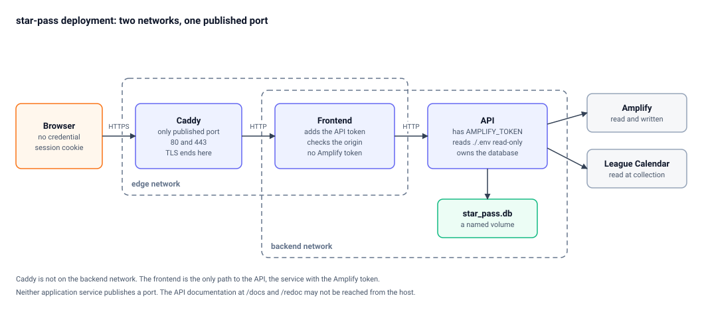
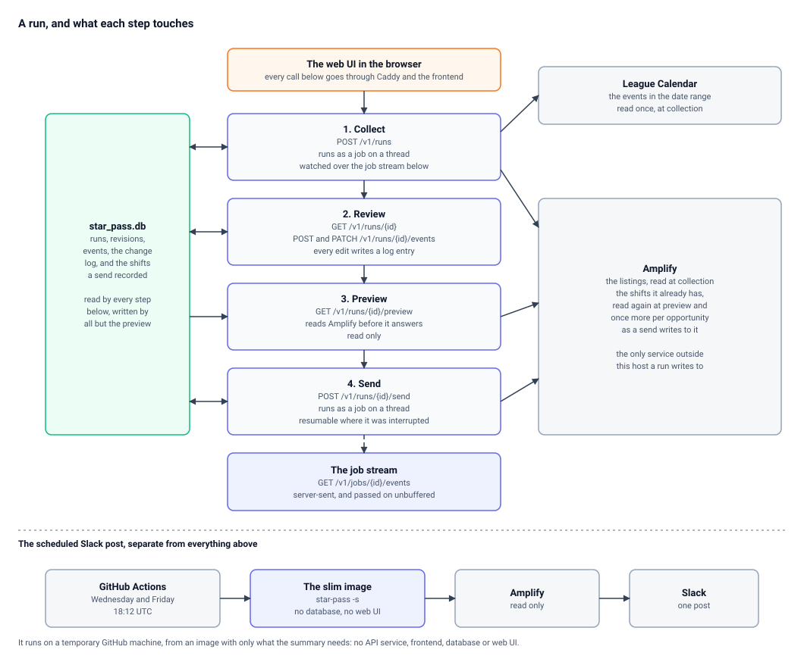

# Architecture

The diagrams below show what a `star-pass` deployment is made of, and
what a run does.

`scripts/generate_architecture.py` generates both diagrams. That file
contains the boxes, networks, arrows, and positions, and
`scripts/_drawing.py` draws them. After editing either file, regenerate
the diagrams and commit the SVG files:

```bash
python scripts/generate_architecture.py
```

Automated tests fail if a committed diagram does not match what the
command generates.

## The Deployment



- **Caddy is the only service that publishes a port.** The frontend and
  the API are not reachable from the host. You may not open the API
  documentation at `/docs` and `/redoc` from outside a deployment.
- **There are two networks, and Caddy is not on the second.** The
  frontend is the only service on both networks. Every request to the
  API passes through the frontend, and the frontend checks that each
  write request came from its own web UI.
- **Only the API has the Amplify token.** The API receives
  `AMPLIFY_TOKEN` from `.env`, and only the API mounts `.env`, read-only.
  The frontend receives two values by name, and neither is the Amplify
  token.
- **Only the API has the database.**

TLS ends at Caddy. By default, Caddy uses its own certificate authority.
Requests between containers are plain HTTP, on networks with no other
services.

## What a Run Does



A run's four steps happen in order. Each step is a request the web UI
makes through Caddy and the frontend.

- **Collecting** reads the events in a date range from the League
  Calendar, reads the Amplify opportunities their categories name, and
  writes a revision.
- **Reviewing** only reads and writes the database. Every edit adds an
  entry to `change_log`.
- **Previewing** only reads Amplify and the database, before it displays
  the shifts to create.
- **Sending** writes to Amplify one opportunity at a time. It reads each
  opportunity immediately before writing to it, and records each batch
  after its request succeeds.

**Collecting and sending run as jobs.** The web UI follows each job's
progress at `GET /v1/jobs/{id}/events`. A resumed send creates only the
shifts Amplify does not have.

The scheduled Slack post, below the dashed line, is separate from runs.
It runs on a different machine, from a different image, with no
database and no web UI. It reads Amplify and posts to Slack twice a
week.

## Reading the Diagrams

- **Orange** is a person at a browser. **Indigo** is a service in this
  repository. **Green** is data that is kept when a container is
  replaced. **Gray** is an outside service.
- A **dashed rectangle** is a network, named in its bottom left corner.
- A **solid arrow** is a request. A **dashed arrow** is something
  watched over time.
- A **double-headed arrow** is read and written.

## Sources

The diagrams are drawn from these files:

- `compose.yaml`: the services, the two networks, the `.env` mount,
  and the volume
- `deploy/caddy/Caddyfile`: the published port, where TLS ends, and the
  Content-Security-Policy
- `docs/api/openapi.json`: the paths in the second diagram
